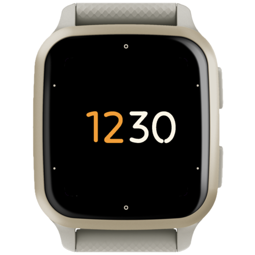
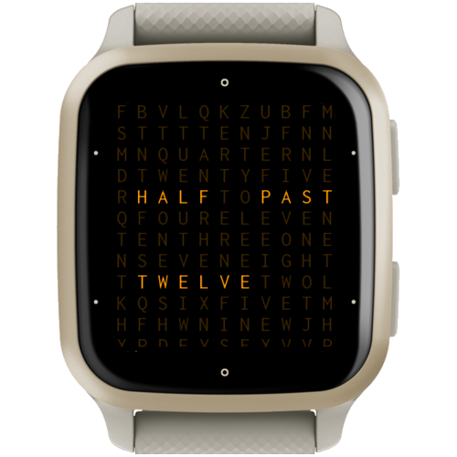
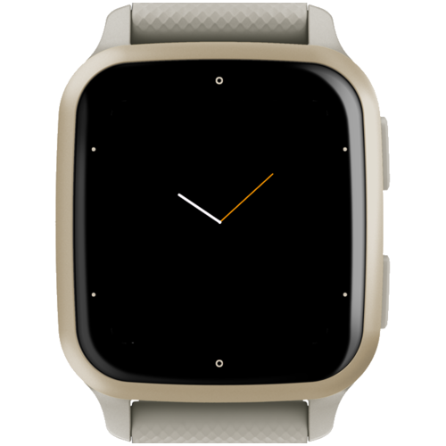
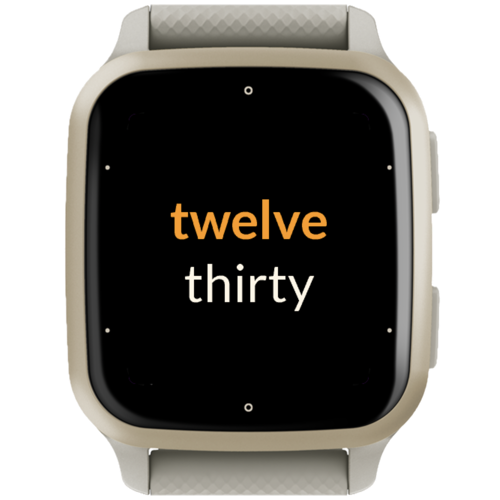

# Garmin Watch Faces

Four independent Monkey C watch faces for Garmin watches, all available in the
[Connect IQ Store](https://apps.garmin.com/developer/4b8f47cc-a9ba-4dd2-9d23-465cc6874999/apps).

| Mini Chrono | Mini Glyphs | Mini Index | Mini Lingua |
| :---: | :---: | :---: | :---: |
| [](https://apps.garmin.com/apps/a76c8507-2093-4d44-b8fa-e8f30d6f8927) | [](https://apps.garmin.com/apps/0f1c6fae-9d28-4be9-909c-eaa7168f8276) | [](https://apps.garmin.com/apps/71d8d765-534d-406b-97d9-532d3d5319c7) | [](https://apps.garmin.com/apps/6ba344de-c869-4ebe-9504-e8c7d2cc3320) |
| Large digital time | English word-clock grid | Minimal analog time | English exact-minute text |
| [Source](mini-chrono/) · [Download](https://apps.garmin.com/apps/a76c8507-2093-4d44-b8fa-e8f30d6f8927) | [Source](mini-glyphs/) · [Download](https://apps.garmin.com/apps/0f1c6fae-9d28-4be9-909c-eaa7168f8276) | [Source](mini-index/) · [Download](https://apps.garmin.com/apps/71d8d765-534d-406b-97d9-532d3d5319c7) | [Source](mini-lingua/) · [Download](https://apps.garmin.com/apps/6ba344de-c869-4ebe-9504-e8c7d2cc3320) |

Each project's `manifest.xml` lists supported devices. Its README records display
constraints and compatibility decisions: [Chrono](mini-chrono/README.md),
[Glyphs](mini-glyphs/README.md), [Index](mini-index/README.md),
[Lingua](mini-lingua/README.md).

## Development setup

1. Install Python 3.9+, a Java runtime supported by your Garmin SDK, and
   [Connect IQ SDK Manager](https://developer.garmin.com/connect-iq/sdk/).
   Download an SDK and the device definitions you need. Java 21 is verified with SDK 9.3.0.
2. Keep your existing signing key outside the repository. Configure its path in
   the ignored `.ciq.local.json`:

   ```json
   {
     "developerKey": "/absolute/path/outside/this/repository/developer_key"
   }
   ```
3. Run `./scripts/ciq doctor` to check Python, Java, SDK tools and key presence.
   A build verifies the key and selected device definition.

The helper discovers the active SDK from SDK Manager's `current-sdk.cfg` on
macOS/Linux. Set `sdk` in the JSON file for another location, or use `CIQ_SDK` and
`CIQ_DEVELOPER_KEY` to override configuration. Otherwise tools are resolved from
`PATH`. Builds need write access to Garmin's SDK/data directories.

See Garmin's [command-line setup guide](https://developer.garmin.com/connect-iq/reference-guides/monkey-c-command-line-setup/)
for SDK setup and creating a key for a new application.

## Build, run and test

Run from the repository root; `venu3` is supported by all four faces.

```sh
./scripts/ciq devices mini-chrono   # No SDK or key needed
./scripts/ciq build mini-chrono venu3
./scripts/ciq simulator
# In another terminal:
./scripts/ciq run mini-chrono venu3
./scripts/ciq test mini-chrono venu3
```

Builds go to `build/<face>/<device>/<face>.prg`. `run` rebuilds and stays attached;
Ctrl-C detaches the terminal. All four faces have review-scheduling tests; Glyphs
and Index also have rendering tests. Run simulator jobs sequentially.

[Verification](docs/verification.md) covers settings, representative displays,
sleep/AOD, captures, burn-in checks and simulator recovery.
[AGENTS.md](AGENTS.md) contains maintenance instructions.

## Export

```sh
./scripts/ciq export mini-chrono
```

This builds every manifest target and writes `build/mini-chrono/mini-chrono.iq`.
All target definitions must be installed. Export uses release compilation from a
neutral temporary directory and checks the decompressed package for private paths
(`bsdtar` required). Upload the package separately to its existing Store listing.

The manifests exclude the former `system8preview` beta target and unavailable
`vivolife` definition; per-face READMEs record other exclusions.

## Review requests

On supported watches, Garmin's native rating screen becomes eligible after two
weeks and 14 observed usage days. Subsequent opportunities follow four, eight,
then twelve weeks apart. Garmin decides whether each request may appear; its SDK
does not report whether the user rated or dismissed it.

Checks run when the face appears or wakes, between 09:00 and 20:00 local time,
with a phone connected and Do Not Disturb off where available. Responses arriving
after the face hides or sleeps are ignored. Failed/denied requests wait at least
24 hours before retrying. Each face preserves its schedule across updates;
existing installations start counting with this feature. Unsupported watches
keep their normal behavior. There is no custom review interface.

## Device support policy

Support hardware where the existing layout and ordinary scaling preserve the
face's appearance. Visual quality and low maintenance take priority over device
count; API eligibility and compilation alone do not establish support.

- Exclude physical cutouts, obstructing analog hands or unusual geometry when
  they require cramped content or a substantially reduced layout. A design
  limitation is sufficient reason; a reproduced crash or clipping defect is unnecessary.
- Keep smaller conventional displays when they remain readable and attractive.
  Size, age and assumed popularity alone do not decide support.
- Prefer fixes shared by a display class. Device-specific layouts, legacy API
  paths and hardware workarounds require an explicit request.
- Keep new targets unsupported until hardware review and representative native
  checks establish layout, settings and low-power behavior. Reuse evidence for
  equivalent displays; inspect new geometry separately. SDK updates trigger review,
  not automatic manifest expansion.
- For fit reports, reproduce where practical, then choose a shared fix or exclusion.
  Record the reason in the face's README and update its manifest/display profiles.
  Index exclusions also belong in `device-exclusions.json`.

Existing per-face decisions remain in effect; this policy does not remove targets
from other faces. Preserve Glyphs' AMOLED-only design.

## Store assets

[Store workflow](docs/store-listings.md) covers listing copy, screenshots and release
handoff. Validate assets without an SDK:

```sh
python3 scripts/check-store-assets
```
